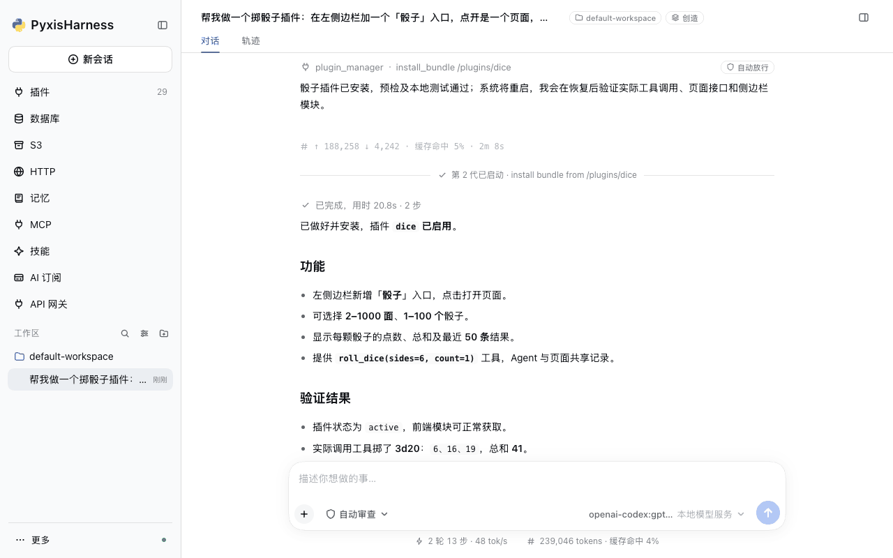
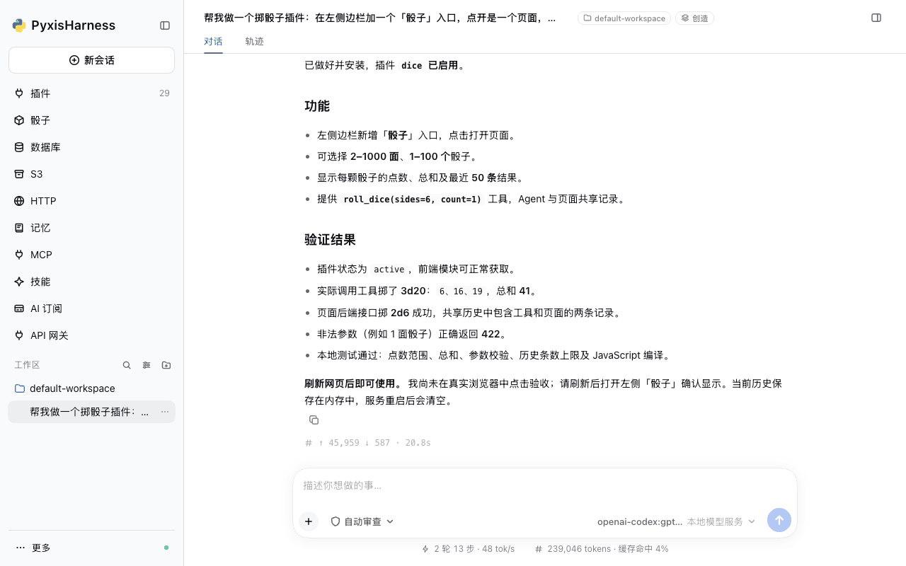
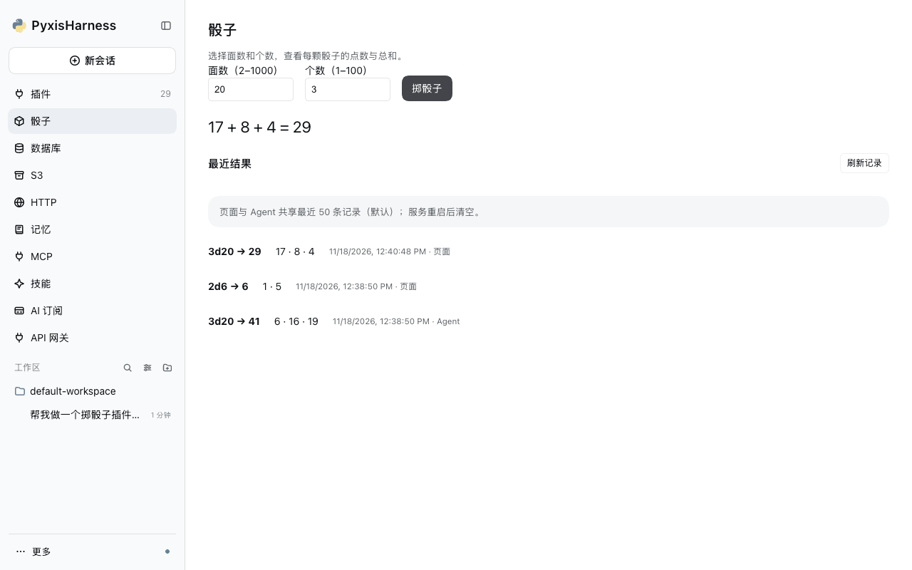

# 快速上手：第一个自定义插件

| 项 | 内容 |
|---|---|
| 结果 | PyxisHarness 运行起来；agent 写出并安装一个插件：左侧边栏的「骰子」页面，加一个 `roll_dice` 工具 |
| 用时 | 约 10 分钟 |
| 前置 | Python 3.12、uv、一个模型 API（OpenAI、Anthropic、DeepSeek、Gemini、OpenRouter，或 OpenAI / Anthropic 兼容端点） |

| 步骤 | 位置 |
|---|---|
| [1. 安装与启动](#1-安装与启动) | 终端 |
| [2. 配置模型](#2-配置模型) | 设置 → 模型 |
| [3. 选择预设与权限](#3-选择预设与权限) | 首页 |
| [4. 描述插件](#4-描述插件) | 输入框 |
| [5. 审查与安装](#5-审查与安装) | 会话 |
| [6. 重启与验证](#6-重启与验证) | 会话 |
| [7. 查看与管理](#7-查看与管理) | 插件页 |
| [8. 使用](#8-使用) | 侧边栏 |

## 1. 安装与启动

```bash
uv sync
uv run pyh init
uv run pyh run
```

浏览器打开 <http://127.0.0.1:8765>。


| 目录 | 内容 |
|---|---|
| `~/.pyharness/profiles/web/` | profile：插件组合、凭据、数据 |
| `~/Documents/pyharness/web/default-workspace/` | 默认工作区：agent 读写文件的地方 |
| `~/Documents/pyharness/web/plugins/` | 插件源码：agent 编写的插件 |

## 2. 配置模型

初始模型是 `echo`，只复述输入。

「更多 → 设置 → 模型 → 添加模型提供方」：


| 页签 | 用于 | 填写 |
|---|---|---|
| 第三方模型提供方 | OpenAI、Anthropic、DeepSeek、Google Gemini、OpenRouter | 提供方类型、API Key |
| 自定义模型 API | 自建服务、中转网关等 OpenAI / Anthropic 兼容端点 | 提供方 ID、API 协议、API Key、Base URL |

1. 「获取可用模型」，勾选要用的模型，「添加所选」。
2. 「应用」。
3. 页面顶部「新会话默认模型」选这个模型。

保存后立即生效。API Key 存入 `~/.pyharness/profiles/web/credentials.yaml`。

## 3. 选择预设与权限

回到首页，把输入框上方的预设从「标准」换成「创造」：


| 预设 | agent 能做的事 |
|---|---|
| 标准 | 日常工作：文件、shell、子 agent |
| 创造 | 标准之上：检查 harness、编写与安装插件 |

再把输入框左下角的权限从「工作区内修改」换成「自动审查」，在确认框里点「切换」：


| 权限 | 需批准的操作（shell 命令、安装插件） |
|---|---|
| 工作区内修改 | 每一次都弹出审批卡片 |
| 自动审查 | 先由模型审查：放行的直接执行，未放行的弹出审批卡片 |
| 完全权限 | 不审查，不询问 |

## 4. 描述插件

写清三件事：界面放在哪、能做什么、怎么验证。

```text
帮我做一个掷骰子插件：在左侧边栏加一个「骰子」入口，点开是一个页面，可以选骰子面数和个数，
点按钮掷骰子，并列出最近的结果；同时提供一个 roll_dice 工具，让 agent 也能掷。装好后验证一下。
```


## 5. 审查与安装

| agent 的步骤 | 处理 |
|---|---|
| 读插件编写技能，取带界面的模板 | 直接执行 |
| 把插件写到 `/plugins/dice/` | 直接执行 |
| 用 shell 检查模块能否导入 | 审查 |
| 安装插件 | 审查 |

审查放行的操作在工具行上带「自动放行」标记，展开可见风险等级。安装放行后，PyxisHarness 把插件装进当前 profile，在独立进程里预检，通过后保存，本轮结束后重启：



| 审查结论 | 结果 |
|---|---|
| 放行 | 直接执行 |
| 未放行 | 弹出审批卡片并写明理由：批准后执行，拒绝则什么都不改 |
| 审查失败 | 弹出审批卡片，由你决定 |

审查按风险分级：工作区内的日常操作直接放行；安装代码、改动工作区之外的文件这类操作，你的指令里要求过才放行。安装的代码在 harness 进程内运行，权限与 harness 相同。

## 6. 重启与验证

重启由 PyxisHarness 自己完成。对话里出现「第 2 代已启动」的分隔行，会话在新一代进程里继续，agent 调用新工具、请求页面的接口来验证，最后给出结果：



验证中的 shell 命令同样经过审查。

## 7. 查看与管理

刷新页面。侧边栏「插件」里多了 `dice`：


| 操作 | 位置 | 生效 |
|---|---|---|
| 停用、启用 | `dice` 行的开关 | 预检后重启 |
| 卸载 | `dice` 行的删除按钮 | 预检后重启；源码保留在 `~/Documents/pyharness/web/plugins/dice/` |

## 8. 使用

侧边栏的「骰子」：



| 用法 | 入口 |
|---|---|
| 自己掷 | 页面：填面数与个数，「掷骰子」 |
| 让 agent 掷 | 任意会话里提出，包括「标准」预设；agent 调用 `roll_dice` |

两种用法的结果都进入页面的「最近结果」，末尾标明来源：页面或 Agent。
