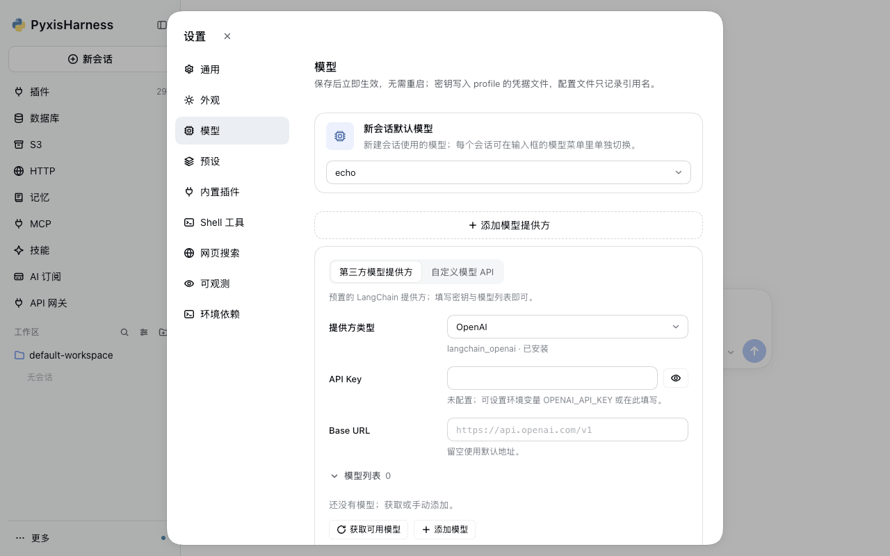
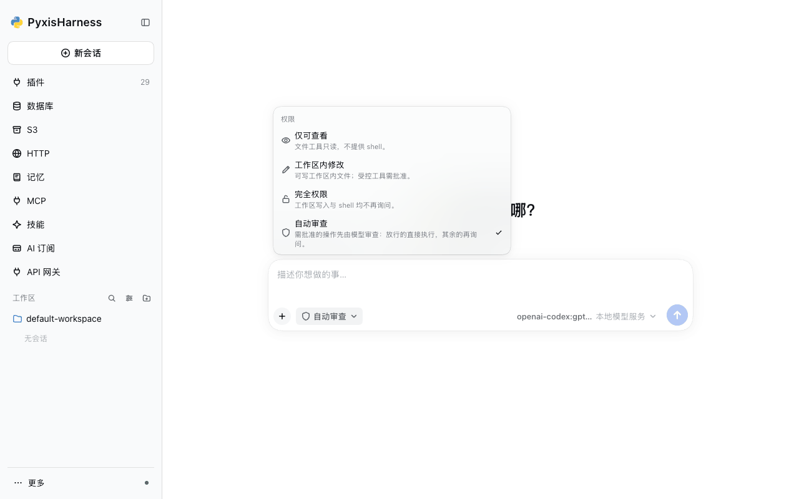
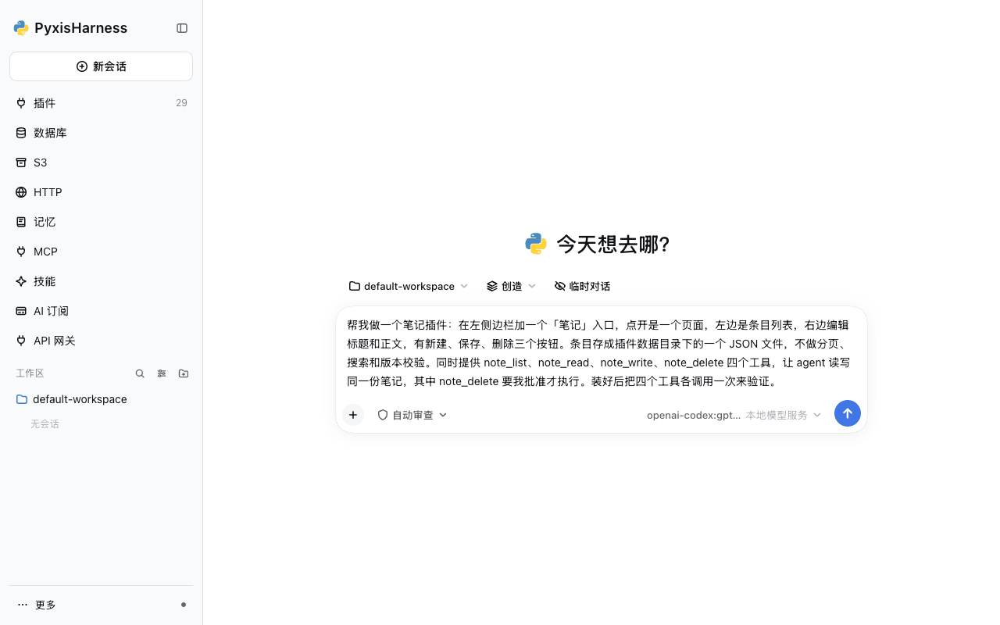
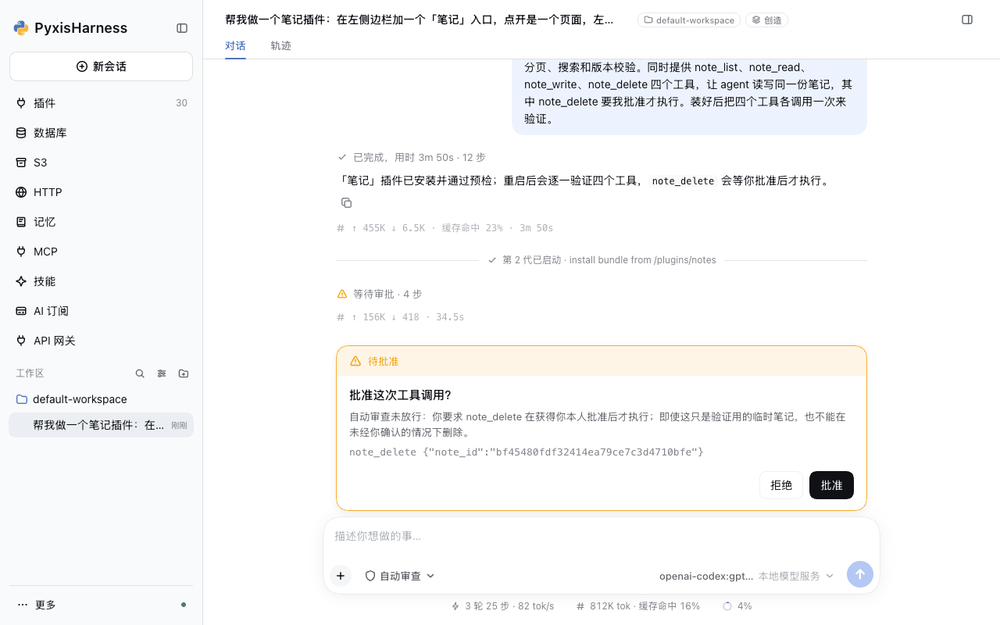
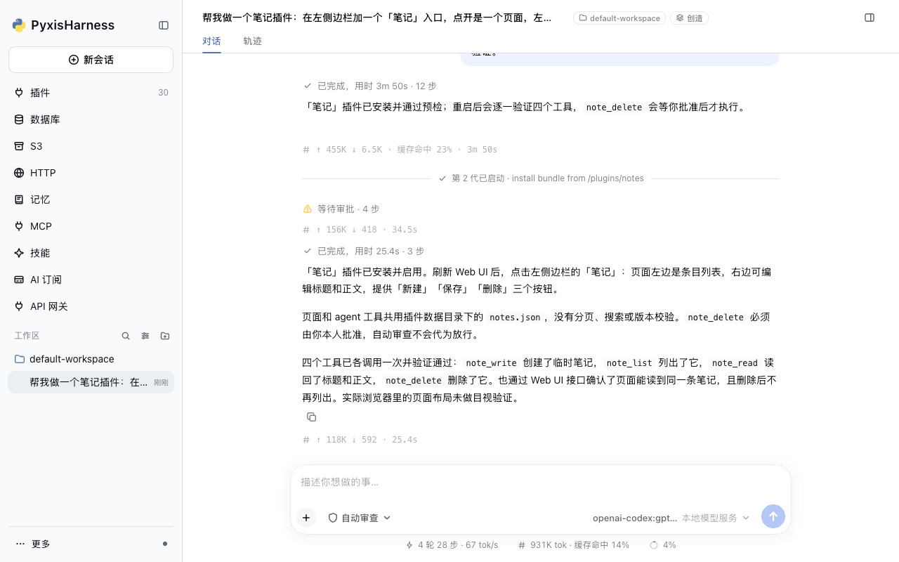
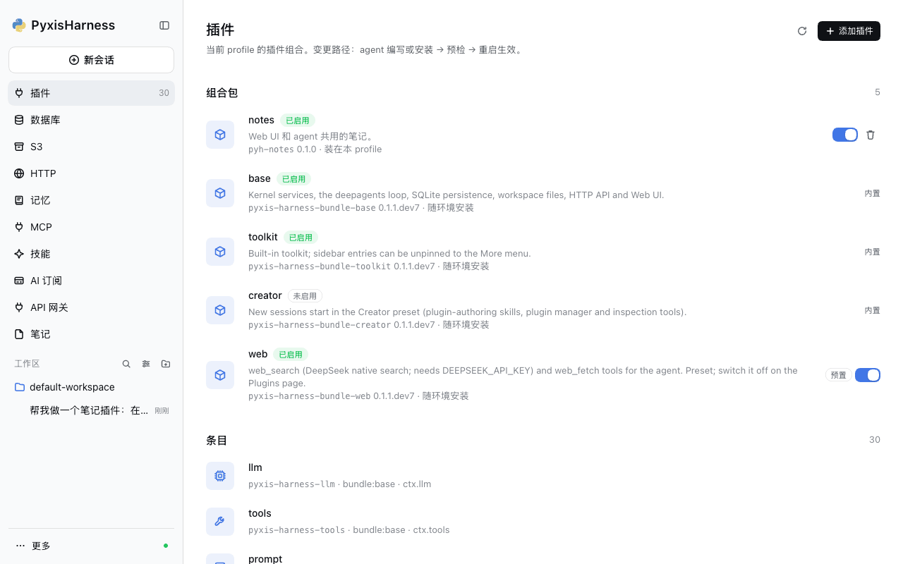
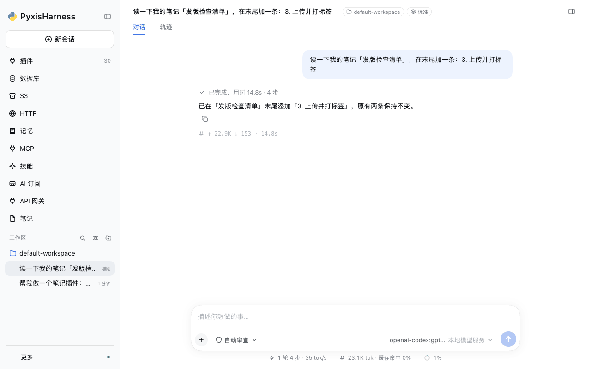
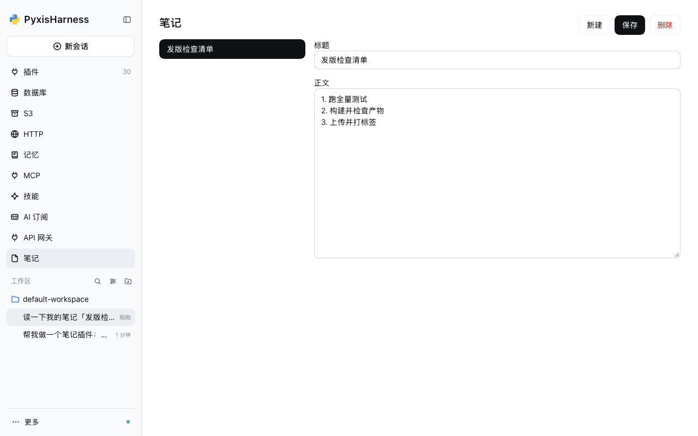

# 快速上手：第一个自定义插件

| 项 | 内容 |
|---|---|
| 结果 | PyxisHarness 运行起来；agent 写出并安装一个插件：左侧边栏的「笔记」页面，加四个 `note_*` 工具；你和 agent 读写同一份笔记 |
| 用时 | 约 15 分钟 |
| 前置 | Python 3.12 及以上、一个模型 API（OpenAI、Anthropic、DeepSeek、Gemini、OpenRouter，或 OpenAI / Anthropic 兼容端点） |
| 平台 | macOS、Linux、Windows |

| 步骤 | 位置 |
|---|---|
| [1. 安装与启动](#1-安装与启动) | 终端 |
| [2. 配置模型](#2-配置模型) | 设置 → 模型 |
| [3. 选择预设与权限](#3-选择预设与权限) | 首页 |
| [4. 描述插件](#4-描述插件) | 输入框 |
| [5. 审查与安装](#5-审查与安装) | 会话 |
| [6. 重启与验证](#6-重启与验证) | 会话 |
| [7. 查看与管理](#7-查看与管理) | 插件页 |
| [8. 使用](#8-使用) | 侧边栏、会话 |

## 1. 安装与启动

```bash
pip install pyxis-harness   # 或 uv tool install pyxis-harness
pyh init
pyh run
```

从源码运行：见 [README](../README.md#快速开始)。

浏览器打开 <http://127.0.0.1:8765>。


`~` 是用户目录；Windows 上为 `C:\Users\<用户名>`。

| 目录 | 内容 |
|---|---|
| `~/.pyharness/profiles/web/` | profile：插件组合、凭据、数据 |
| `~/Documents/pyharness/web/default-workspace/` | 默认工作区：agent 读写文件的地方 |
| `~/Documents/pyharness/web/plugins/` | 插件源码：agent 编写的插件 |

## 2. 配置模型

初始模型是 `echo`，只复述输入。

「更多 → 设置 → 模型 → 添加模型提供方」：



| 页签 | 用于 | 填写 |
|---|---|---|
| 第三方模型提供方 | OpenAI、Anthropic、DeepSeek、Google Gemini、OpenRouter | 提供方类型、API Key |
| 自定义模型 API | 自建服务、中转网关等 OpenAI / Anthropic 兼容端点 | 提供方 ID、API 协议、API Key、Base URL |

1. 「获取可用模型」，勾选要用的模型，「添加所选」。
2. 「应用」。
3. 页面顶部「新会话默认模型」选这个模型。

保存后立即生效。API Key 存入 `~/.pyharness/profiles/web/credentials.yaml`。

## 3. 选择预设与权限

回到首页，把输入框上方的预设从「标准」换成「创造」：


| 预设 | agent 能做的事 |
|---|---|
| 标准 | 日常工作：文件、shell、子 agent |
| 创造 | 标准之上：检查 harness、编写与安装插件 |

shell 在 macOS 与 Linux 上是 bash，在 Windows 上是 PowerShell。

新会话的权限是「自动审查」；输入框左下角的权限菜单可以换：



| 权限 | 需批准的操作（shell 命令、安装插件） |
|---|---|
| 工作区内修改 | 每一次都弹出审批卡片 |
| 自动审查 | 先由模型审查：放行的直接执行，未放行的弹出审批卡片 |
| 完全权限 | 不审查，不询问 |

## 4. 描述插件

```text
帮我做一个笔记插件：在左侧边栏加一个「笔记」入口，点开是一个页面，左边是条目列表，右边编辑标题和正文，
有新建、保存、删除三个按钮。条目存成插件数据目录下的一个 JSON 文件，不做分页、搜索和版本校验。
同时提供 note_list、note_read、note_write、note_delete 四个工具，让 agent 读写同一份笔记，
其中 note_delete 要我批准才执行。装好后把四个工具各调用一次来验证。
```



| 写明的事 | 示例里的句子 |
|---|---|
| 界面 | 左侧边栏的「笔记」入口；左边列表，右边编辑，三个按钮 |
| 数据 | 插件数据目录下的一个 JSON 文件 |
| 范围 | 不做分页、搜索和版本校验 |
| 工具 | 四个 `note_*` 工具；`note_delete` 经你批准 |
| 验证 | 四个工具各调用一次 |

范围写得越具体，agent 做得越快。

## 5. 审查与安装

| agent 的步骤 | 处理 |
|---|---|
| 读插件编写技能，查 harness 的接口 | 直接执行 |
| 把插件写到 `/plugins/notes/` | 直接执行 |
| 用 shell 检查模块能否导入 | 审查 |
| 安装插件 | 审查 |

这一步约 4–9 分钟，随模型而变。

审查放行的操作在工具行上带「自动放行」标记，展开可见风险等级。安装放行后，PyxisHarness 把插件装进当前 profile，在独立进程里预检，通过后保存，本轮结束后重启；预检未通过时 agent 修改后再装：


| 审查结论 | 结果 |
|---|---|
| 放行 | 直接执行 |
| 未放行 | 弹出审批卡片并写明理由：批准后执行，拒绝则什么都不改 |
| 审查失败 | 弹出审批卡片，由你决定 |

审查按风险分级：工作区内的日常操作直接放行；安装代码、改动工作区之外的文件这类操作，你的指令里要求过才放行。安装的代码在 harness 进程内运行，权限与 harness 相同。

agent 提出与任务无关的操作（例如读取工作区之外的文件）时，审查不放行：拒绝，agent 换一种做法继续。

## 6. 重启与验证

重启由 PyxisHarness 自己完成。对话里出现「第 2 代已启动」的分隔行，会话在新一代进程里继续，agent 依次调用四个工具来验证。

`note_delete` 弹出审批卡片：这是需求里要求的，审查不替你放行。



批准后，agent 删除它创建的临时笔记，给出结果：



验证中的 shell 命令同样经过审查。

## 7. 查看与管理

刷新页面。侧边栏「插件」里多了 `notes`：



| 操作 | 位置 | 生效 |
|---|---|---|
| 停用、启用 | `notes` 行的开关 | 预检后重启 |
| 卸载 | `notes` 行的删除按钮 | 预检后重启；源码保留在 `~/Documents/pyharness/web/plugins/notes/` |

## 8. 使用

| 步骤 | 入口 | 结果 |
|---|---|---|
| 记一条 | 侧边栏「笔记」：「新建」，填标题与正文，「保存」 | 条目出现在左边的列表 |
| 让 agent 改 | 任意会话里提出，包括「标准」预设 | agent 调用 `note_list`、`note_read`、`note_write` |
| 回到页面 | 侧边栏「笔记」，点开这一条 | 正文里有 agent 加的内容 |

让 agent 改：

```text
读一下我的笔记「发版检查清单」，在末尾加一条：3. 上传并打标签
```



回到页面：



页面与工具读写同一个文件。让 agent 删除条目时，`note_delete` 弹出审批卡片。

页面由 agent 编写，布局与文案每次略有不同。

| 侧边栏入口 | 内容 |
|---|---|
| 记忆 | 内置：agent 积累的履历与项目经验 |
| 笔记 | 本文的插件：你自己记的条目 |
