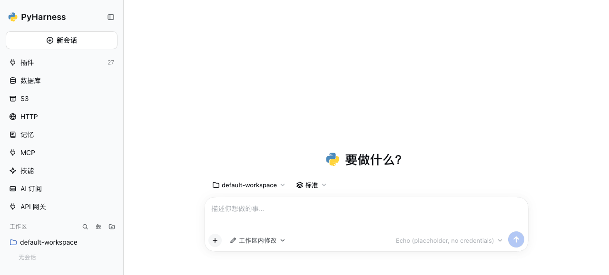
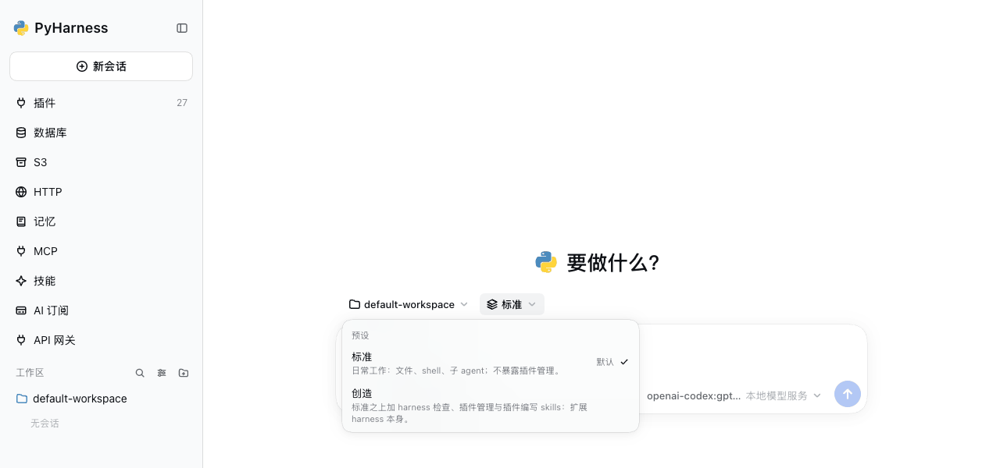
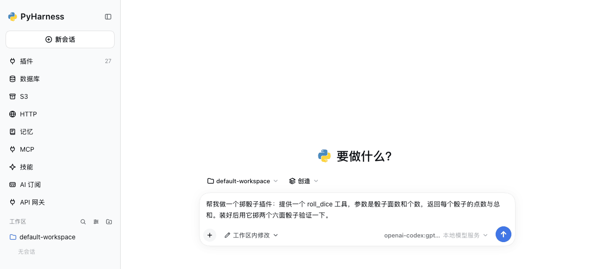
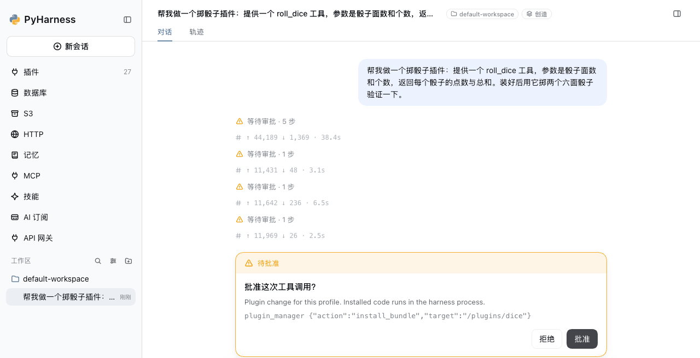
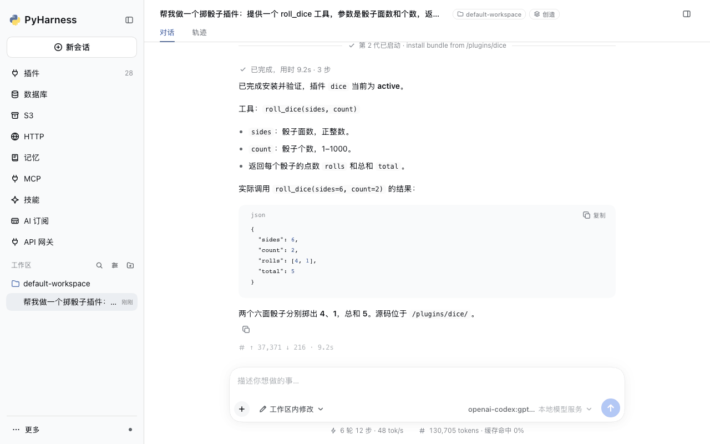
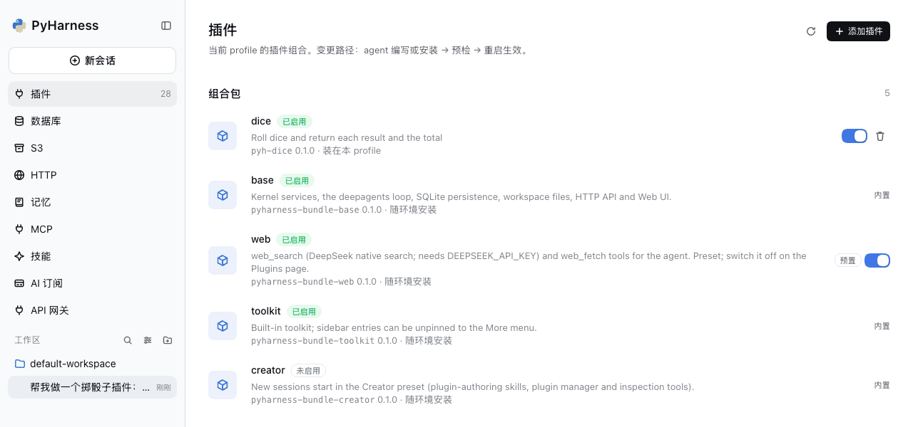
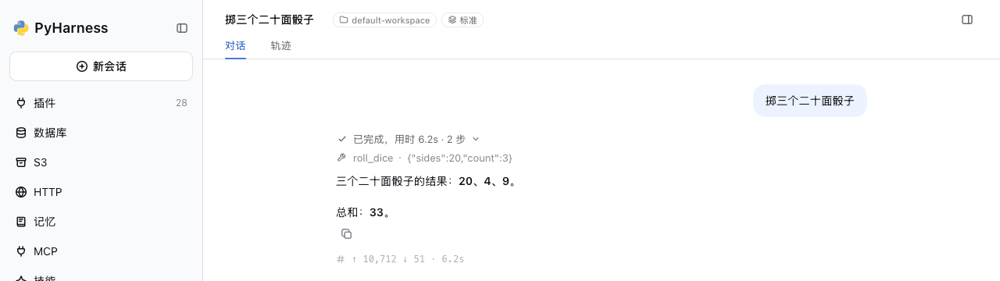

# 快速上手：第一个自定义插件

| 项 | 内容 |
|---|---|
| 结果 | pyharness 运行起来；agent 写出并安装一个插件，提供 `roll_dice` 工具 |
| 用时 | 约 10 分钟 |
| 前置 | Python 3.12、uv、一个模型 API（OpenAI、Anthropic、DeepSeek、Gemini、OpenRouter，或 OpenAI / Anthropic 兼容端点） |

| 步骤 | 位置 |
|---|---|
| [1. 安装与启动](#1-安装与启动) | 终端 |
| [2. 配置模型](#2-配置模型) | 设置 → 模型 |
| [3. 选择「创造」预设](#3-选择创造预设) | 首页 |
| [4. 描述插件](#4-描述插件) | 输入框 |
| [5. 审批安装](#5-审批安装) | 会话 |
| [6. 重启与验证](#6-重启与验证) | 会话 |
| [7. 查看与管理](#7-查看与管理) | 插件页 |
| [8. 使用](#8-使用) | 新会话 |

## 1. 安装与启动

```bash
uv sync
uv run pyh init
uv run pyh run
```

浏览器打开 <http://127.0.0.1:8765>。



| 目录 | 内容 |
|---|---|
| `~/.pyharness/profiles/web/` | profile：插件组合、凭据、数据 |
| `~/Documents/pyharness/web/default-workspace/` | 默认工作区：agent 读写文件的地方 |
| `~/Documents/pyharness/web/plugins/` | 插件源码：agent 编写的插件 |

## 2. 配置模型

初始模型是 `echo`，只复述输入。

「更多 → 设置 → 模型 → 添加模型提供方」：


| 页签 | 用于 | 填写 |
|---|---|---|
| 第三方模型提供方 | OpenAI、Anthropic、DeepSeek、Google Gemini、OpenRouter | 提供方类型、API Key |
| 自定义模型 API | 自建服务、中转网关等 OpenAI / Anthropic 兼容端点 | 提供方 ID、API 协议、API Key、Base URL |

1. 「获取可用模型」，勾选要用的模型，「添加所选」。
2. 「应用」。
3. 页面顶部「新会话默认模型」选这个模型。

保存后立即生效。API Key 存入 `~/.pyharness/profiles/web/credentials.yaml`。

## 3. 选择「创造」预设

回到首页，把输入框上方的预设从「标准」换成「创造」：



| 预设 | agent 能做的事 |
|---|---|
| 标准 | 日常工作：文件、shell、子 agent |
| 创造 | 标准之上：检查 harness、编写与安装插件 |

## 4. 描述插件

写清四件事：工具名、参数、返回值、怎么验证。

```text
帮我做一个掷骰子插件：提供一个 roll_dice 工具，参数是骰子面数和个数，
返回每个骰子的点数与总和。装好后用它掷两个六面骰子验证一下。
```



## 5. 审批安装

| agent 的步骤 | 需要审批 |
|---|---|
| 读插件编写技能，取模板 | 否 |
| 把插件写到 `/plugins/dice/` | 否 |
| 用 shell 检查模块能否导入 | 是：每条 shell 命令 |
| 安装插件 | 是 |

安装的审批卡片：



| 选择 | 结果 |
|---|---|
| 批准 | 安装进当前 profile → 在独立进程里预检 → 通过后保存，本轮结束后重启 |
| 拒绝 | 什么都不改 |

安装的代码在 harness 进程内运行，权限与 harness 相同。审批是唯一的闸门。

## 6. 重启与验证

重启由 pyharness 自己完成，页面不用刷新。会话在新一代进程里继续，agent 调用新工具验证：



| 界面上的标记 | 含义 |
|---|---|
| 「第 2 代已启动 · install bundle from /plugins/dice」 | 新进程已接管，原因是这次安装 |
| 侧边栏「插件」的数字加一 | 新条目已加载 |

## 7. 查看与管理

侧边栏「插件」：



| 操作 | 位置 | 生效 |
|---|---|---|
| 停用、启用 | `dice` 行的开关 | 预检后重启 |
| 卸载 | `dice` 行的删除按钮 | 预检后重启；源码保留 |

## 8. 使用

新工具对所有会话可用，包括「标准」预设。点开回复上方的步骤行可以看到工具调用：



## 插件的源码

```text
~/Documents/pyharness/web/plugins/dice/
  AGENTS.md              设计说明
  pyproject.toml         发行包与 entry point
  pyh_dice/__init__.py   导入
  pyh_dice/plugin.py     插件：roll_dice 工具
  pyh_dice/bundle.py     bundle.yaml 的路径
  pyh_dice/bundle.yaml   挂载位置
```

这次生成的 `plugin.py`（agent 每次写出的代码会有差异）：

```python
class DiceInput(BaseModel):
    sides: Annotated[int, Field(strict=True, ge=1, description="Number of faces per die; a positive integer.")]
    count: Annotated[int, Field(strict=True, ge=1, le=1000, description="Number of dice to roll, from 1 to 1000.")]


@tool(args_schema=DiceInput)
def roll_dice(sides: int, count: int) -> dict[str, Any]:
    """Roll dice independently and return each die's result and their total."""
    rolls = [secrets.randbelow(sides) + 1 for _ in range(count)]
    return {"sides": sides, "count": count, "rolls": rolls, "total": sum(rolls)}


def apply(ctx: Any, config: Config) -> None:
    ctx.tools.register(roll_dice)
```

| 要做的事 | 做法 |
|---|---|
| 修改插件 | 在「创造」会话里提出修改；agent 改 `/plugins/dice/` 后重新安装，再走一次审批与重启 |
| 手工修改 | 编辑上面目录里的文件，然后在「创造」会话里让 agent 重新安装 `/plugins/dice` |

`/plugins/` 在每个「创造」会话里都是这同一个目录，与会话选的工作区无关。

## 常见情况

| 现象 | 原因与处理 |
|---|---|
| 回复只是复述输入 | 模型还是 `echo`：第 2 步 |
| agent 说没有插件管理工具 | 会话是「标准」预设：新建会话，选「创造」 |
| 安装结果是 rejected | 预检没通过，profile 没有变化；错误已返回给 agent，它会修正后重装 |
| 重启后新一代启动失败 | pyharness 恢复上一份可用配置并再次启动；会话里有回滚提示 |
| 端口被占用 | `PYH_PORT=8770 uv run pyh run` |

## 延伸

| 主题 | 文档 |
|---|---|
| 自扩展的机制、审批与边界 | [docs/self-extension.md](../docs/self-extension.md) |
| 插件的形式与扩展点 | [docs/plugins.md](../docs/plugins.md) |
| 预检、重启、回滚 | [docs/lifecycle.md](../docs/lifecycle.md) |
